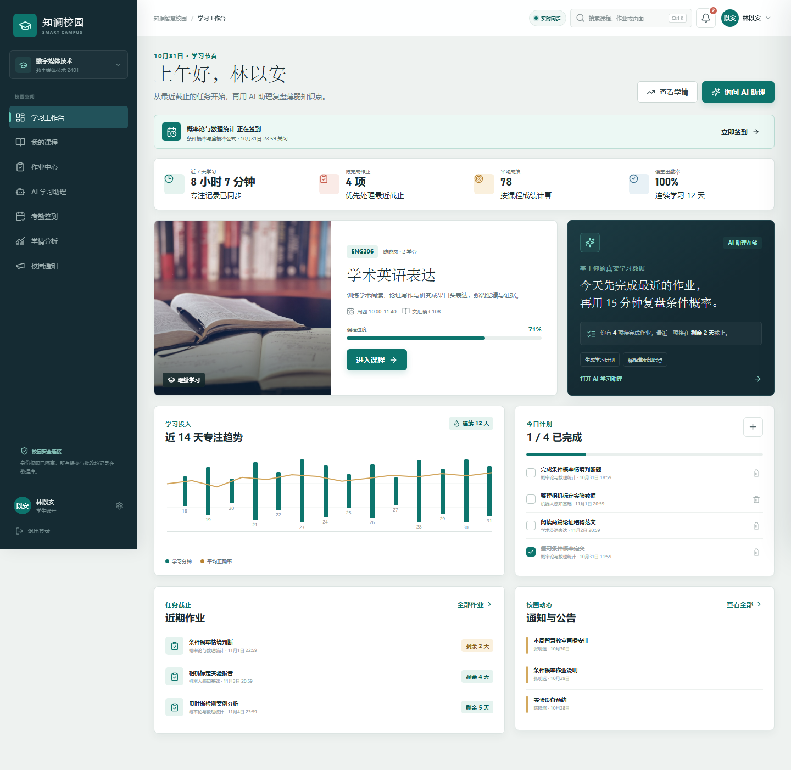
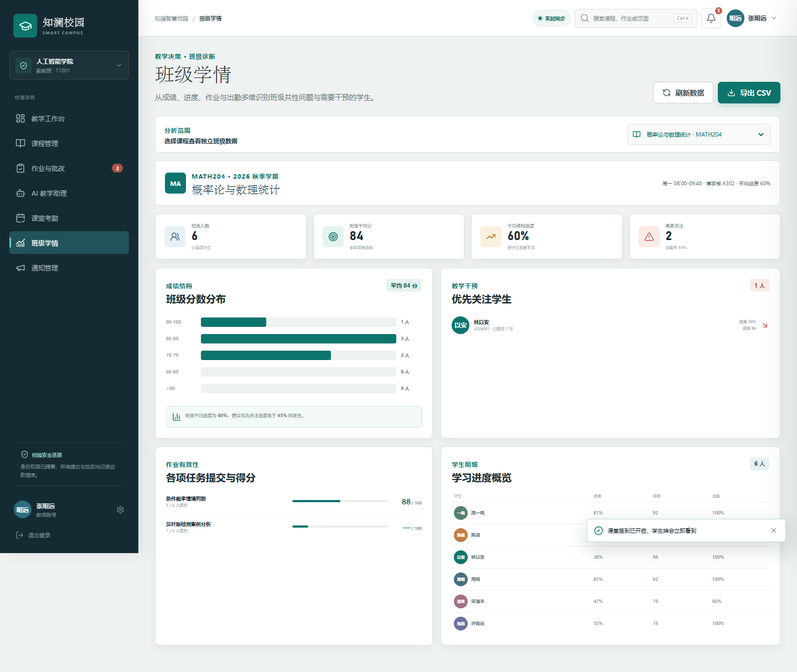
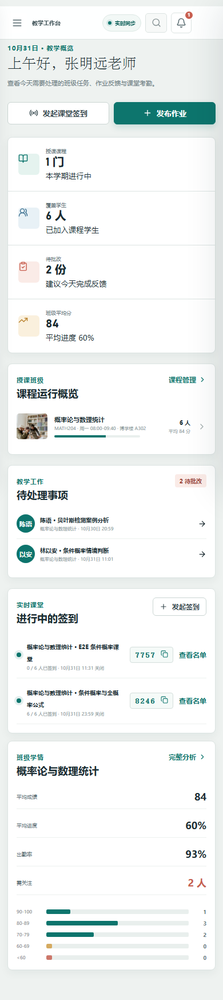

# 知澜智慧校园

面向高校学生与教师的 AI 智慧教育平台。项目将 AI 助教、课程学习、作业批改、课堂签到、学情分析、校园通知和任务计划放在同一套真实可用的业务流程中，使用 React 18、TypeScript、Node.js 和 SQLite 构建。

本项目依据用户提供的 2025 年 AI WEB 网页开发挑战赛章程实现。2026 年实际赛程、组别和提交入口请以大赛官方最新通知为准。

## 提交材料

| 材料 | 位置 | 状态 |
| --- | --- | --- |
| 源代码与 Git 仓库 | https://github.com/Flechazo124/zhilan-smart-campus | 已公开 |
| 在线演示 | http://weigxh.cn:5555 | 已上线 |
| 项目介绍、技术架构、安装指南 | `README.md` | 已完成 |
| 环境变量模板 | `.env.example` | 已完成 |
| 依赖清单与锁文件 | `package.json`、`pnpm-lock.yaml` | 已完成 |
| 技术文档 PDF | `artifacts/submission/知澜智慧校园-技术文档.pdf` | 已完成 |
| 功能验收截图 | `artifacts/screenshots/` | 已完成 28 张 |
| 团队信息 | `docs/TEAM.md` | 已完成团队角色与公开信息 |
| 部署与运维说明 | `docs/DEPLOYMENT.md` | 已完成 |
| 提交前核验表 | `docs/SUBMISSION_CHECKLIST.md` | 已完成 |

## 核心能力

- 学生与教师双角色认证：学生自助注册，教师邀请码注册，服务端角色权限隔离。
- 实时校园数据：SSE 按用户推送作业发布、作业提交、评分、签到、课程和通知变化，页面无需手动刷新。
- AI 学习与教学助理：结合课程、作业、成绩等上下文回答，会话历史持久化。
- 课程管理：教师创建课程、添加学生；学生查看课程进度、作业、公告和考勤。
- 作业闭环：教师发布任务，学生提交或修改，教师逐份批改，评分自动通知学生。
- 课堂考勤：教师创建限时数字签到码，学生真实签到，重复签到和错误签到码由服务端拒绝。
- 学情分析：个人学习趋势、课程掌握度、班级分数结构、风险学生、作业表现和 CSV 导出。
- 校园通知：教师发布全校或课程通知，系统为对应账号生成站内提醒。
- 个人计划：任务创建、完成状态切换和删除均写入数据库。
- 响应式界面：桌面、平板、手机布局，所有可见操作均连接真实状态或接口。

## 技术栈

| 层级 | 技术 |
| --- | --- |
| 前端 | React 18、TypeScript 5.7、Vite 5、Lucide React |
| 后端 | Node.js 原生 HTTP、REST API |
| 数据库 | SQLite，使用 Node 内置 `node:sqlite` |
| 认证 | scrypt 加盐密码哈希、HttpOnly Cookie、数据库会话 |
| AI | OpenAI-compatible Chat Completions 接口 + 明确标注的本地教学引擎回退 |
| 测试 | Node Test Runner、Playwright、Microsoft Edge |

## 运行要求

- Node.js `>= 22.13.0`，推荐 Node.js 24 LTS。
- pnpm `10+` 或 `11+`。
- 无需外部数据库服务。

## 本地启动

进入克隆后的项目目录，以下命令不依赖固定磁盘路径：

```powershell
cd zhilan-smart-campus
corepack enable
pnpm install
Copy-Item .env.example .env
pnpm seed
pnpm dev
```

- 一个命令同时启动前端开发服务与后端 API。
- 前端开发地址：`http://127.0.0.1:5174`
- 本地 API 端口：`5175`

生产模式只需构建后启动统一服务：

```powershell
pnpm build
pnpm start
```

在线演示地址：`http://weigxh.cn:5555`

## 演示账号

| 身份 | 账号 | 密码 |
| --- | --- | --- |
| 学生 | `2024001` | `Campus@2026` |
| 教师 | `T1001` | `Teacher@2026` |

教师注册默认邀请码为 `ZHILAN-TEACHER-2026`，可在 `.env` 中通过 `TEACHER_INVITE_CODE` 修改。正式部署前必须更换默认邀请码和演示密码。

## AI 配置

复制 `.env.example` 为 `.env`，配置任意 OpenAI-compatible 服务：

```dotenv
AI_API_KEY=your-key
AI_BASE_URL=https://api.openai.com/v1
AI_MODEL=gpt-4o-mini
```

配置后，AI 页面会显示“远程模型”。未配置密钥时，系统明确显示“知澜本地教学引擎”，由可离线运行的教学规则生成回答，不会伪装成远程大模型。远程接口异常时会自动回退，并在界面提示。

如果项目用于赛事评审，建议在部署平台配置可用的第三方模型密钥，确保评审期间接口稳定；也可以使用团队自建且兼容 OpenAI Chat Completions 的模型服务。

## 生产环境变量

```dotenv
PORT=5175
SESSION_DAYS=7
TEACHER_INVITE_CODE=replace-with-a-strong-invite-code
DATABASE_PATH=/persistent-data/zhilan.db
AI_API_KEY=
AI_BASE_URL=https://api.openai.com/v1
AI_MODEL=gpt-4o-mini
```

SQLite 数据库必须放在持久化磁盘。适合 Render、Railway、腾讯云、华为云或普通云主机等支持常驻 Node 进程和持久盘的平台。纯静态平台无法运行当前后端，不建议只部署 `dist`。

## 测试与验收

API 回归：

```powershell
pnpm test:api
```

覆盖健康检查、未登录保护、学生注册、教师邀请码注册、登录、角色隔离、课程详情、作业提交修改、教师批改、通知、签到、重复签到、任务、AI 会话和 CSV 导出。测试使用 `data/test-runs` 下的独立随机数据库，不污染演示数据库。

浏览器端到端回归：

```powershell
pnpm test:e2e
```

测试会使用 Playwright 和 Microsoft Edge，启动独立端口与独立数据库，完成学生和教师主要流程，检查浏览器控制台错误，并生成 19 张截图。

登录与注册专项回归：

```powershell
pnpm test:auth
```

该测试会同时启动 Vite 与独立 API，通过真实浏览器完成学生注册、教师邀请码注册、重复账号校验、退出与重新登录，并确认代理链路不再返回 502。

实时数据双浏览器回归：

```powershell
pnpm test:realtime
```

测试使用教师与学生两个独立浏览器会话，验证教师发布作业后学生端自动出现新任务，以及学生签到后教师打开的名单自动从“未签到”变为“已签到”。

执行全部自动化回归：

```powershell
pnpm test:all
```

当前已验证：

- `pnpm build`：通过。
- `pnpm test:api`：全部通过。
- `pnpm test:e2e`：全部通过，浏览器控制台除登录前预期的会话探测 401 外无错误。
- `pnpm test:auth`：登录与双角色注册链路通过。
- `pnpm test:realtime`：作业发布与签到状态跨会话实时更新通过。
- 桌面 `1440 x 1000` 与手机 `390 x 844` 已截图检查。

## 截图

完整截图位于 `artifacts/screenshots/`。







## 团队信息

团队名称：**微光胡闹队**

参赛项目：**传智杯 Web 网页开发赛**

参赛学校：**北华航天工业学院**

团队成员：**袁正、胡开元、屈轶宸**

指导教师：**牛静**

作品定位：面向高校课堂的 AI 智慧教育平台，强调真实认证、持久化数据、角色权限和跨会话实时协作。

| 分工 | 主要职责 |
| --- | --- |
| 产品与体验 | 需求分析、角色流程、信息架构、响应式界面与可用性验收 |
| 前端开发 | React 页面、类型化 API 客户端、实时事件接入、交互状态与视觉实现 |
| 服务端与 AI | Node.js API、SQLite 数据模型、认证与权限、AI 适配与本地回退 |
| 测试与交付 | API/E2E/实时回归、截图验收、部署文档、技术文档与提交包核验 |

公开仓库：https://github.com/Flechazo124/zhilan-smart-campus

在线演示：http://weigxh.cn:5555

详细的团队角色说明见 [docs/TEAM.md](docs/TEAM.md)。

## 项目结构

```text
zhilan-smart-campus/
├─ server/
│  ├─ index.mjs          # REST API、认证、权限与生产静态文件服务
│  ├─ realtime.mjs       # SSE 实时连接、事件推送与心跳清理
│  ├─ db.mjs             # SQLite 表结构、哈希、会话与演示数据
│  ├─ ai.mjs             # 远程模型适配器与本地教学引擎
│  ├─ config.mjs         # .env 读取与运行配置
│  └─ seed.mjs           # 可重复执行的数据库初始化入口
├─ src/
│  ├─ components/        # 应用外壳、认证页与通用组件
│  ├─ pages/             # 七个真实业务页面
│  ├─ App.tsx            # 会话恢复、页面导航与数据刷新
│  ├─ useRealtime.ts     # EventSource 自动重连与实时事件分发
│  ├─ api.ts             # 类型化 API 客户端
│  ├─ types.ts           # 前端数据契约
│  └─ styles.css         # 响应式设计系统与页面样式
├─ public/assets/        # 课程与登录视觉素材
├─ tests/                # API 与浏览器回归
├─ scripts/dev.mjs       # 同时启动 Vite 与 API 的开发启动器
├─ artifacts/screenshots # 验收截图
└─ docs/                 # 架构、部署、团队、比赛提交与演示说明
```

## 安全说明

- 密码使用 `scrypt` 随机盐哈希，不保存明文。
- 会话令牌仅存于 HttpOnly、SameSite Cookie，数据库只保存 SHA-256 摘要。
- 写请求校验 Origin；登录接口按来源限制高频尝试。
- 所有数据库查询使用参数绑定；SQLite 启用外键和 WAL。
- 教师创建课程、发布作业、批改、考勤和通知前均检查课程归属。
- 学生提交、签到和查看课程前均检查选课关系。
- 修改密码后，该账号其他会话全部失效并重新签发当前会话。

## 当前边界

- 当前作业提交为文本形式，不包含附件上传和对象存储。
- 当前 AI 助手不执行工具调用，不自动修改成绩或教务数据，只提供教学建议。
- SQLite 适合单实例比赛演示和中小规模试点；多实例高并发部署应迁移到 PostgreSQL。
- 网盘链接、API Key 和演示视频链接需要参赛者在提交前按实际部署填写。

更完整的评审映射、商业与运营说明见 [docs/COMPETITION_SUBMISSION.md](docs/COMPETITION_SUBMISSION.md)，技术设计见 [docs/ARCHITECTURE.md](docs/ARCHITECTURE.md)，部署说明见 [docs/DEPLOYMENT.md](docs/DEPLOYMENT.md)，提交核验见 [docs/SUBMISSION_CHECKLIST.md](docs/SUBMISSION_CHECKLIST.md)，视频脚本见 [docs/DEMO_SCRIPT.md](docs/DEMO_SCRIPT.md)。
